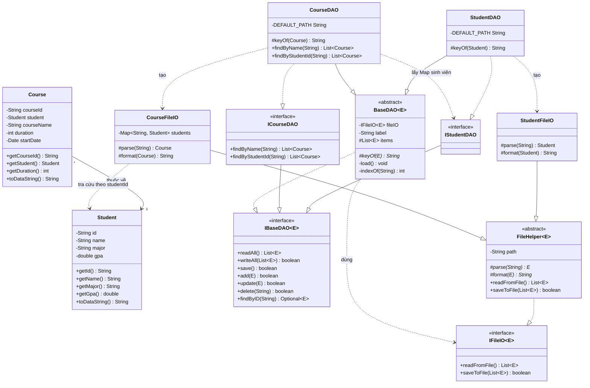
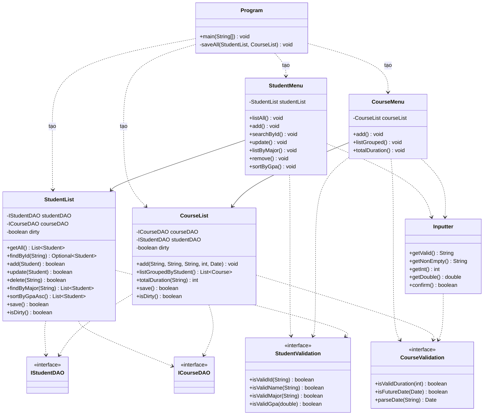
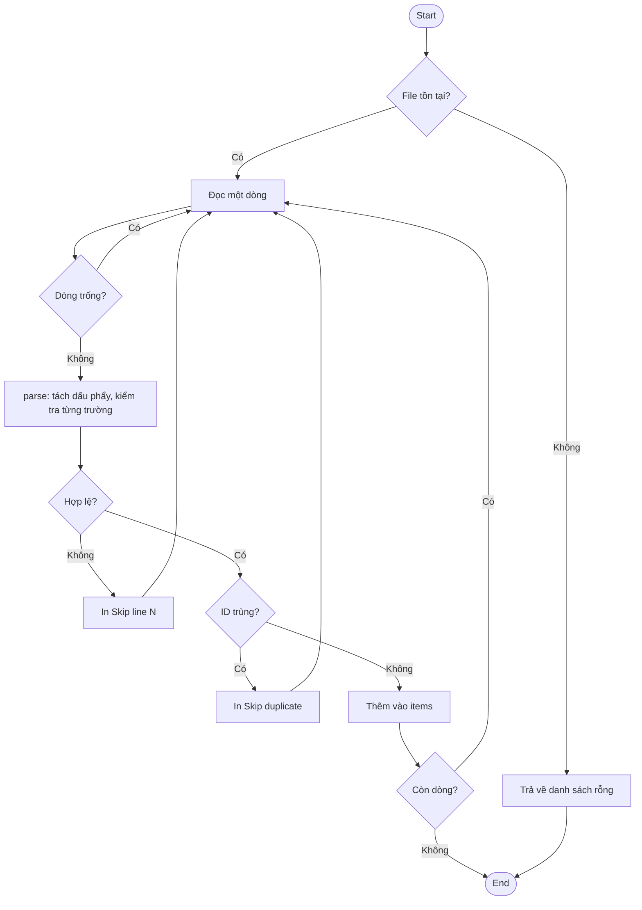
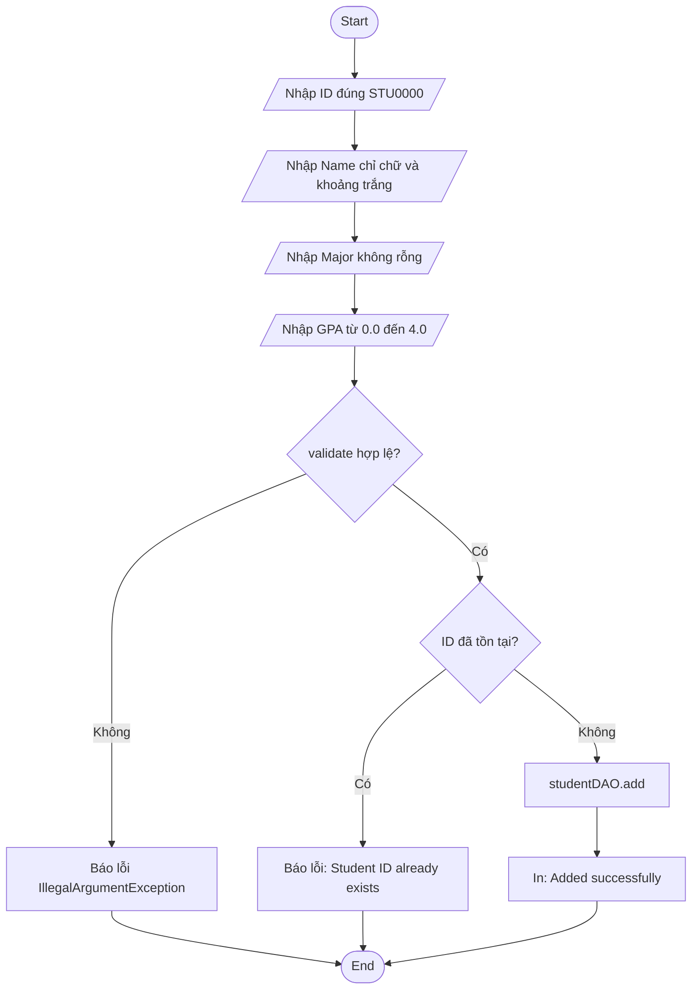
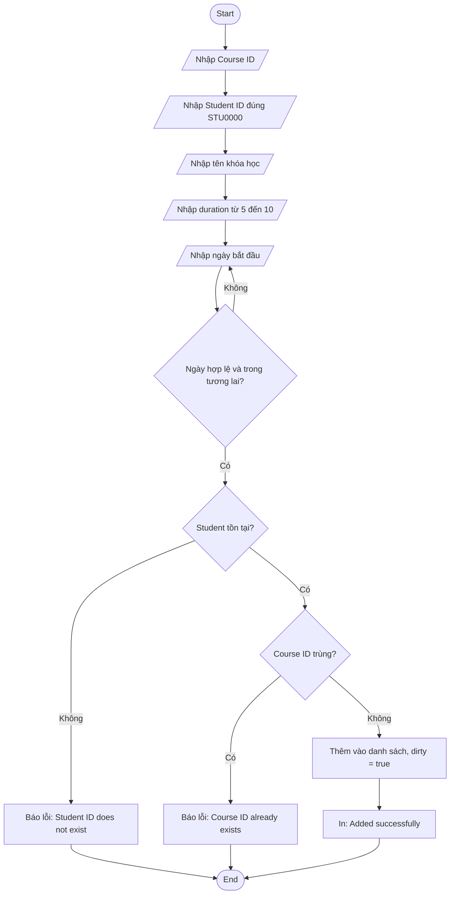
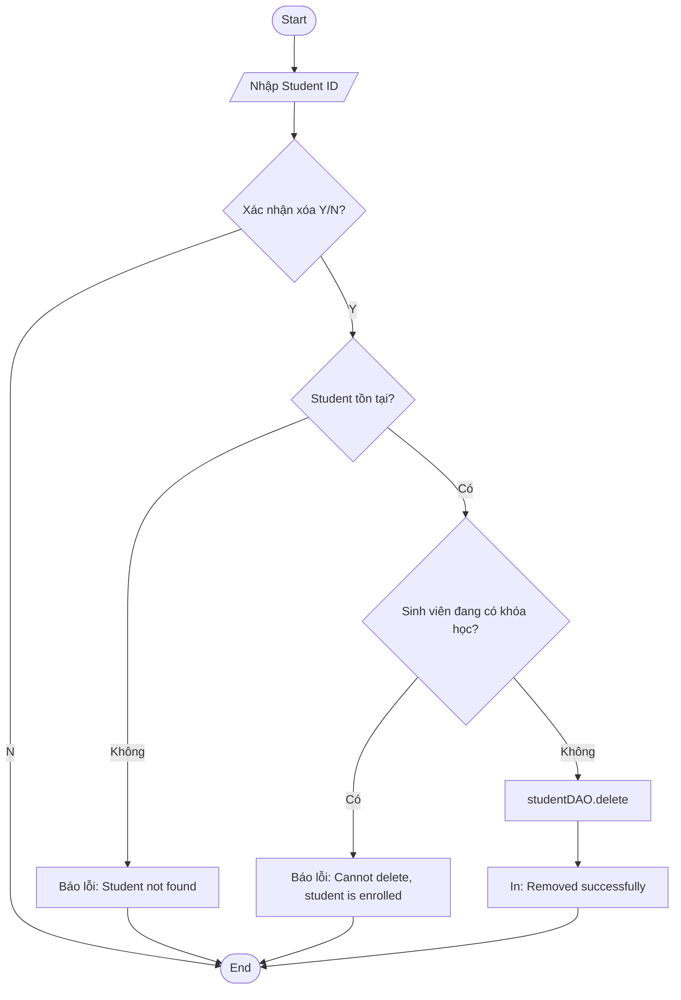
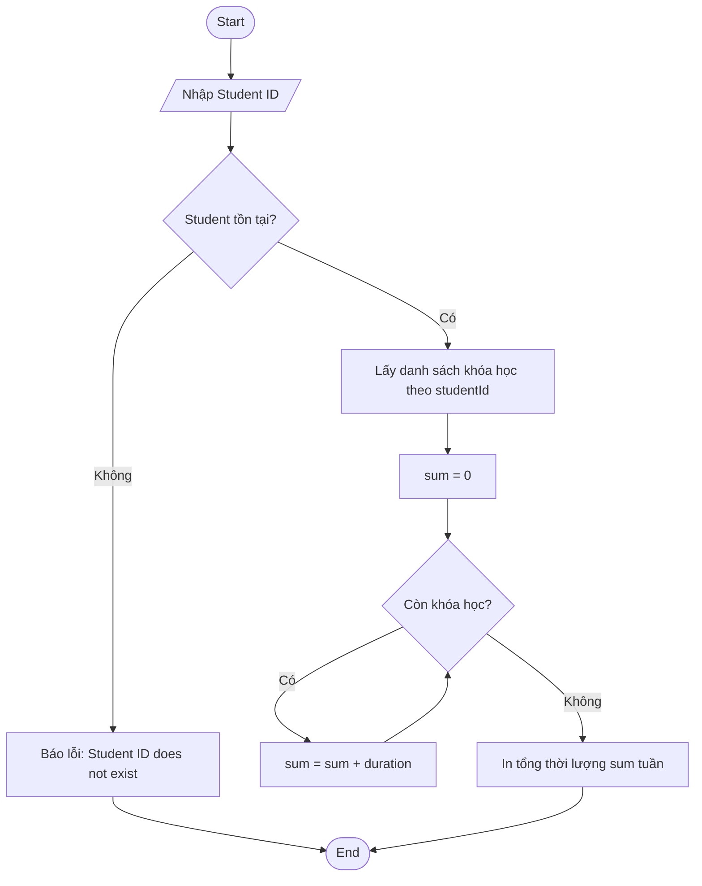

# LAB3 – Student & Course Management System

Ứng dụng Java console quản lý **sinh viên** và **khóa học**, dữ liệu lưu bằng file text. Chương trình được thiết kế theo mô hình nhiều tầng (layered architecture) và áp dụng các nguyên lý hướng đối tượng (OOP).

## Mục lục

1. [Giới thiệu](#1-giới-thiệu)
2. [Phân tích yêu cầu](#2-phân-tích-yêu-cầu)
3. [Kiến trúc hệ thống](#3-kiến-trúc-hệ-thống)
4. [Class Diagram](#4-class-diagram)
5. [Thiết kế OOP](#5-thiết-kế-oop)
6. [Flowchart](#6-flowchart)
7. [Cấu trúc dữ liệu](#7-cấu-trúc-dữ-liệu)
8. [Xử lý lỗi và validate](#8-xử-lý-lỗi-và-validate)
9. [Kiểm thử](#9-kiểm-thử)
10. [Hạn chế và hướng phát triển](#10-hạn-chế-và-hướng-phát-triển)
11. [Hướng dẫn chạy](#11-hướng-dẫn-chạy)

---

## 1. Giới thiệu

- **Ngôn ngữ:** Java 8
- **Giao diện:** Console (menu số 1–12)
- **Lưu trữ:** `Students.txt`, `Courses.txt`
- **Mục tiêu:** quản lý sinh viên, khóa học; áp dụng OOP, tách tầng, tái sử dụng code bằng generics, interface và lớp trừu tượng.

## 2. Phân tích yêu cầu

### 2.1 Chức năng

| # | Chức năng | Lớp xử lý chính |
|---|---|---|
| 1 | Liệt kê tất cả sinh viên | `StudentMenu.listAll` |
| 2 | Thêm sinh viên | `StudentMenu.add` → `StudentList.add` |
| 3 | Tìm sinh viên theo ID | `StudentMenu.searchById` |
| 4 | Cập nhật sinh viên theo ID | `StudentMenu.update` → `StudentList.update` |
| 5 | Liệt kê sinh viên theo ngành | `StudentList.findByMajor` |
| 6 | Thêm khóa học | `CourseMenu.add` → `CourseList.add` |
| 7 | Liệt kê khóa học theo sinh viên (nhóm) | `CourseList.listGroupedByStudent` |
| 8 | Tổng thời lượng học theo Student ID | `CourseList.totalDuration` |
| 9 | Xóa sinh viên theo ID | `StudentList.delete` |
| 10 | Sắp xếp sinh viên theo GPA | `StudentList.sortByGpaAsc` |
| 11 | Lưu dữ liệu ra file | `Program.saveAll` |
| 12 | Thoát chương trình | `Program.main` |

### 2.2 Ràng buộc nghiệp vụ

| Đối tượng | Ràng buộc |
|---|---|
| Student ID | Đúng định dạng `STU0000` (không phân biệt hoa/thường khi nhập), duy nhất |
| Name | Chỉ chữ cái và khoảng trắng (hỗ trợ tiếng Việt có dấu), tối thiểu 2 ký tự |
| Major | Không rỗng |
| GPA | Từ 0.0 đến 4.0 |
| Course ID | Không rỗng, duy nhất |
| Student của Course | Phải tồn tại |
| Duration | Số nguyên từ 5 đến 10 (tuần) |
| Start date | Định dạng `dd/MM/yyyy` (nhập được nhiều dạng), phải là ngày trong tương lai |
| Xóa sinh viên | Không được xóa nếu sinh viên đang có khóa học |

## 3. Kiến trúc hệ thống

Chương trình chia thành 5 tầng. Mỗi tầng chỉ phụ thuộc tầng bên dưới (thông qua interface khi có thể).

| Tầng | Package | Thành phần | Vai trò |
|---|---|---|---|
| Presentation | `Presentation`, `Presentation.Menu` | `Program`, `StudentMenu`, `CourseMenu` | Hiển thị menu, nhập/xuất dữ liệu |
| Business | `BusinessObject` | `StudentList`, `CourseList` | Luật nghiệp vụ, validate, điều phối DAO |
| Core | `Core.Entities`, `Core.Interfaces` | `Student`, `Course`, `IBaseDAO`, `IStudentDAO`, `ICourseDAO` | Thực thể và hợp đồng (interface) |
| Data Object | `DataObject.DAO` | `BaseDAO<E>`, `StudentDAO`, `CourseDAO` | Giữ dữ liệu trong bộ nhớ, CRUD, gọi FileIO |
| Utilities | `Utilities.FileIO`, `Utilities.Validation` | `IFileIO`, `FileHelper`, `StudentFileIO`, `CourseFileIO`, `Inputter`, `StudentValidation`, `CourseValidation`, `BaseValidation` | Đọc/ghi file, nhập liệu, kiểm tra hợp lệ |

**Luồng gọi:** `Menu → List (Business) → DAO → FileIO → file .txt`

## 4. Class Diagram

Do sơ đồ đầy đủ khá lớn, class diagram được tách thành 2 hình.

### 4.1 Hình (a): Entity + DAO + FileIO



### 4.2 Hình (b): Presentation + Business



### 4.3 Giải thích quan hệ

| Quan hệ | Ví dụ | Ý nghĩa |
|---|---|---|
| Kế thừa `extends` (`--\|>`, **nét liền**) | `StudentDAO` → `BaseDAO`; `IStudentDAO` → `IBaseDAO` | Tái sử dụng CRUD / mở rộng interface |
| Triển khai `implements` (`..\|>`, **nét đứt**) | `BaseDAO` → `IBaseDAO` | Tuân thủ hợp đồng của interface |
| Association (`-->`, nét liền) | `Course` → `Student` | Mỗi khóa học thuộc một sinh viên |
| Dependency (`..>`, **nét đứt**) | `BaseDAO` ..> `IFileIO`; `StudentList` ..> `IStudentDAO`; `Program` ..> `StudentMenu` | Chỉ dùng interface/đối tượng khác, không sở hữu |

**Quy ước:** quan hệ tới *interface* dùng nét đứt; `extends` dùng nét liền.

## 5. Thiết kế OOP

### 5.1 Bốn tính chất OOP

| Nguyên lý | Minh họa trong code | Giải thích |
|---|---|---|
| **Đóng gói** | `Student`, `Course` có field `private` + getter/setter | Dữ liệu chỉ truy cập qua phương thức; việc kiểm tra hợp lệ nằm ở tầng Business |
| **Kế thừa** | `StudentDAO`, `CourseDAO` extends `BaseDAO<E>`; `StudentFileIO`, `CourseFileIO` extends `FileHelper<E>` | Logic CRUD và đọc/ghi file viết một lần ở lớp cha |
| **Trừu tượng** | `IBaseDAO`, `IFileIO`, `BaseDAO` (abstract), `FileHelper` (abstract) | Tầng trên chỉ biết interface, không biết dữ liệu lưu bằng file hay database |
| **Đa hình** | `StudentList` giữ `IStudentDAO`; `FileHelper` gọi `parse()`/`format()` do lớp con cài đặt | Cùng một lời gọi, hành vi khác nhau tùy lớp con |

### 5.2 Design pattern

| Pattern | Áp dụng | Lợi ích |
|---|---|---|
| **Template Method** | `FileHelper.readFromFile()` định nghĩa khung đọc file, `parse()`/`format()` để lớp con hiện thực; `BaseDAO` tương tự với `keyOf()` | Tránh lặp code giữa Student và Course |
| **DAO** | `BaseDAO`, `StudentDAO`, `CourseDAO` | Tách truy cập dữ liệu khỏi nghiệp vụ |
| **Dependency Injection** | `StudentList(IStudentDAO, ICourseDAO)`, `StudentDAO(IFileIO<Student>)` | Dễ thay thế, dễ kiểm thử |
| **Generics** | `IBaseDAO<E>`, `BaseDAO<E>`, `FileHelper<E>` | Một lớp dùng cho nhiều entity |

### 5.3 Nguyên tắc SOLID

| Nguyên tắc | Minh họa |
|---|---|
| **S** – Single Responsibility | Menu lo nhập/xuất; List lo nghiệp vụ; DAO lo lưu trữ; FileIO lo đọc/ghi file |
| **O** – Open/Closed | Thêm entity mới chỉ cần thêm lớp con của `BaseDAO` và `FileHelper` |
| **L** – Liskov Substitution | `StudentDAO` thay được `BaseDAO<Student>` ở mọi nơi |
| **I** – Interface Segregation | `IBaseDAO` (chung) tách riêng với `ICourseDAO` (phương thức đặc thù) |
| **D** – Dependency Inversion | Tầng Business phụ thuộc interface `IStudentDAO`/`ICourseDAO`, không phụ thuộc lớp cụ thể |

### 5.4 Một số quyết định thiết kế

- **`Course` giữ tham chiếu `Student` thay vì `studentId`:** truy cập trực tiếp tên, ngành của sinh viên; file chỉ lưu `studentId`, `CourseFileIO` tra bằng `Map<String, Student>` để dựng lại đối tượng.
- **`CourseDAO` cần `StudentDAO` tạo trước:** để parse dòng khóa học thì phải tra được sinh viên.
- **Tách `StudentList` khỏi `StudentDAO`:** DAO chỉ lưu/đọc, `StudentList` chứa luật nghiệp vụ (validate, chặn xóa sinh viên đang học).
- **Cờ `dirty`:** theo dõi thay đổi chưa lưu để hỏi người dùng khi thoát.
- **Muốn đổi sang database:** viết thêm lớp implement `IStudentDAO`/`ICourseDAO`, các tầng trên không phải sửa.

## 6. Flowchart

### 6.1 Luồng chính (`Program.main`)

```mermaid
flowchart TD
    A([Start]) --> B["Tạo StudentDAO, CourseDAO<br/>đọc file vào bộ nhớ"]
    B --> C["Tạo StudentList, CourseList, Menu"]
    C --> D[/"Hiển thị menu 1-12, nhập choice"/]
    D --> E{"choice"}
    E -->|"1-5, 9, 10"| F["StudentMenu xử lý"]
    E -->|"6-8"| G["CourseMenu xử lý"]
    E -->|"11"| H["saveAll: ghi Students.txt và Courses.txt"]
    E -->|"12"| I{"Có thay đổi chưa lưu?"}
    I -->|"Có"| J{"Xác nhận lưu?"}
    J -->|"Y"| H
    J -->|"N"| K
    I -->|"Không"| K["In Goodbye"]
    F --> L{"choice = 12?"}
    G --> L
    H --> L
    L -->|"Không"| D
    K --> M([End])
```



### 6.2 Nạp dữ liệu từ file khi khởi động



### 6.3 Thêm sinh viên (chức năng 2)



### 6.4 Thêm khóa học (chức năng 6)



### 6.5 Xóa sinh viên (chức năng 9)



### 6.6 Tính tổng thời lượng (chức năng 8)



## 7. Cấu trúc dữ liệu

### 7.1 `Students.txt`

```
id, name, major, gpa
STU0001, Nguyen Van A, Software Engineering, 3.4
```

### 7.2 `Courses.txt`

```
courseId, studentId, courseName, duration, startDate
CSE201, STU0002, Database Systems, 10, 15/09/2025
```

### 7.3 Cách xử lý dòng lỗi

File mẫu cố ý chứa các dòng sai để minh họa việc xử lý lỗi:

| Dòng | Lỗi | Kết quả |
|---|---|---|
| `MAT301, STU0003 Discrete Mathematics, 8 20/09/2025` | Thiếu dấu phẩy (chỉ có 3 trường) | Bỏ qua, in `Skip line` |
| `PRJ301 STU0001, Java Web Project, 6; 20/10/2025` | Sai dấu phân cách | Bỏ qua |
| `PRO192- STU0003- Java Programming- 8- 25/10/2025` | Dùng `-` thay `,` | Bỏ qua |
| `CSE201, STU0002, ...` xuất hiện 2 lần | Trùng khóa | Giữ dòng đầu, in `Skip duplicate` |

## 8. Xử lý lỗi và validate

| Vị trí | Cơ chế |
|---|---|
| **Nhập liệu** (`Inputter`) | Vòng lặp nhập lại đến khi hợp lệ, in thông báo lỗi |
| **Nghiệp vụ** (`StudentList`, `CourseList`) | Ném `IllegalArgumentException`, `Program` bắt và in `Error: ...` |
| **Đọc file** (`FileHelper`) | Bỏ qua dòng sai định dạng, không làm dừng chương trình |
| **Ghi file** (`BaseDAO.save`) | Bắt exception, trả về `false`, `Program` báo `Failed to save` |
| **Ngày tháng** | `ResolverStyle.STRICT`: `31/02/2025` bị từ chối |

Định dạng ngày nhập được chấp nhận: `d/M/uuuu`, `M/d/uuuu`, `MMM d, uuuu`, `d MMM uuuu`, `MMMM d, uuuu`, ... (tự bỏ hậu tố `st`, `nd`, `rd`, `th`).

## 9. Kiểm thử

| # | Chức năng | Dữ liệu vào | Kết quả mong đợi |
|---|---|---|---|
| 1 | Thêm SV | ID `STU12` | `Invalid ID. Format: STU0000.` và nhập lại |
| 2 | Thêm SV | ID `STU0001` (đã có) | `Student ID already exists.` |
| 3 | Thêm SV | Name `Nguyen123` | `Invalid name (letters and spaces only).` |
| 4 | Thêm SV | GPA `4.5` | Yêu cầu nhập lại (0.0 – 4.0) |
| 5 | Thêm SV | Dữ liệu hợp lệ | `Added successfully (not saved to file yet).` |
| 6 | Tìm SV | ID không tồn tại | `Student not found.` |
| 7 | Cập nhật SV | Enter trống cho mọi trường | Giữ nguyên giá trị cũ |
| 8 | Thêm khóa học | Duration `3` | Yêu cầu nhập lại (5 – 10) |
| 9 | Thêm khóa học | Ngày trong quá khứ | `Invalid date or not a future date.` |
| 10 | Thêm khóa học | Student ID không tồn tại | `Student ID does not exist!` |
| 11 | Thêm khóa học | Course ID trùng | `Course ID already exists!` |
| 12 | Xóa SV | SV đang có khóa học | `Cannot delete: student is enrolled in course(s).` |
| 13 | Tổng thời lượng | `STU0003` | Tổng duration các khóa học hợp lệ của STU0003 |
| 14 | Sắp xếp | Chọn chức năng 10 | Danh sách tăng dần theo GPA |
| 15 | Khởi động | `Courses.txt` có dòng lỗi | In `Skip line ...`, chương trình vẫn chạy |
| 16 | Thoát | Còn thay đổi chưa lưu | Hỏi `Save before quitting? (Y/N)` |

## 10. Hạn chế và hướng phát triển

**Hạn chế hiện tại**

- `StudentList` gọi `studentDAO.save()` ngay sau mỗi thao tác, nên cờ `dirty` không được dùng như `CourseList` (cách xử lý hai danh sách chưa đồng nhất).
- Khóa duy nhất của `Course` trong `BaseDAO` là `courseId`, trong khi `Course.equals` so sánh theo `courseId` và sinh viên.
- Chưa có chức năng cập nhật/xóa khóa học.
- Dữ liệu lưu file text, không hỗ trợ truy cập đồng thời.

**Hướng phát triển**

- Đồng nhất cơ chế `dirty`/lưu giữa hai danh sách.
- Thêm chức năng sửa/xóa khóa học, tìm khóa học theo tên (`ICourseDAO.findByName` đã có sẵn).
- Thay file text bằng database bằng cách viết lớp DAO mới implement các interface hiện có.
- Viết unit test (JUnit) cho tầng Business bằng DAO giả.

## 11. Hướng dẫn chạy

```bash
# Biên dịch (từ thư mục gốc dự án)
javac -d build/classes -sourcepath src src/Presentation/Program.java

# Chạy (chạy tại thư mục gốc để đường dẫn src/DataObject/data/*.txt hợp lệ)
java -cp build/classes Presentation.Program
```

Hoặc mở bằng NetBeans/IntelliJ và chạy lớp `Presentation.Program`.

## Cấu trúc thư mục

```
src/
├── Presentation/
│   ├── Program.java
│   └── Menu/ (StudentMenu, CourseMenu)
├── BusinessObject/ (StudentList, CourseList)
├── Core/
│   ├── Entities/ (Student, Course)
│   └── Interfaces/ (IBaseDAO, IStudentDAO, ICourseDAO)
├── DataObject/
│   ├── DAO/ (BaseDAO, StudentDAO, CourseDAO)
│   └── data/ (Students.txt, Courses.txt)
└── Utilities/
    ├── FileIO/ (IFileIO, FileHelper, StudentFileIO, CourseFileIO)
    └── Validation/ (Inputter, BaseValidation, StudentValidation, CourseValidation)
```